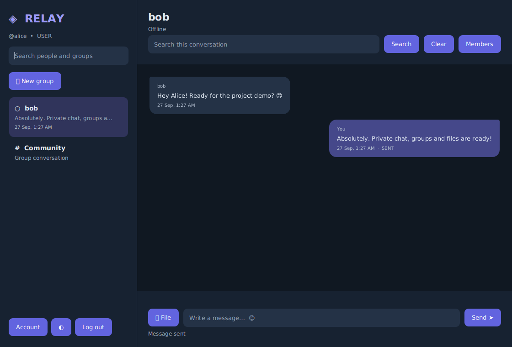
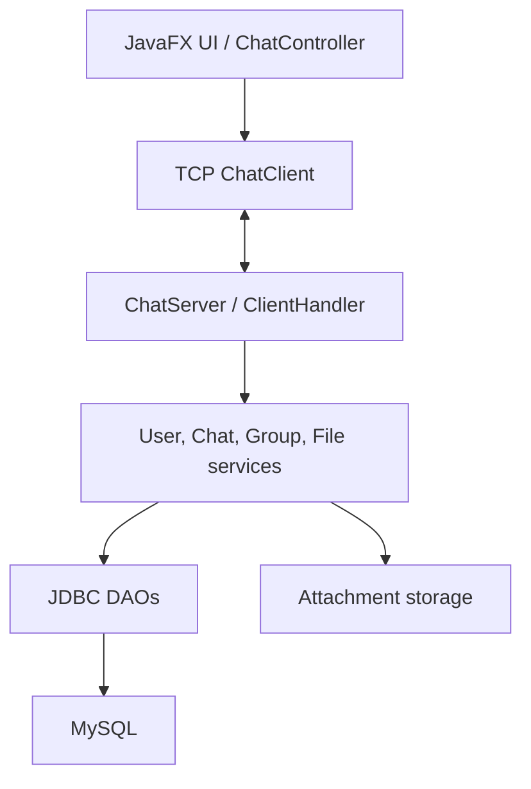

# Relay — Multi-Client Chat Application

A Java desktop chat application built with **JavaFX, TCP sockets, JDBC, and MySQL**. Relay upgrades a console-based Core Java chat project into a desktop app with private messaging, groups, message receipts, offline delivery, and file attachments.

> This is a learning/portfolio project. It uses a custom TCP protocol and does not currently provide TLS or end-to-end encryption.

## Contents

- [Features](#features)
- [Tech stack](#tech-stack)
- [Screenshots](#screenshots)
- [Architecture](#architecture)
- [Getting started](#getting-started)
- [Configuration](#configuration)
- [Run tests](#run-tests)
- [Project structure](#project-structure)
- [Database overview](#database-overview)
- [Security notes and limitations](#security-notes-and-limitations)
- [Core Java concepts demonstrated](#core-java-concepts-demonstrated)

## Features

- **Accounts:** registration, BCrypt password hashing, password changes, and administrator controls.
- **Private chat:** direct conversations, saved message history, offline delivery, and SENT → DELIVERED → SEEN receipts.
- **Group chat:** create groups, view members, manage membership, leave groups, and transfer group administration when needed.
- **Community:** a shared group for broadcast-style messages.
- **Presence and typing:** online/offline status, last-seen information, and typing indicators.
- **File sharing:** image, PDF, TXT, DOC, and DOCX attachments up to 10 MiB, with access checks for downloads.
- **Search and history:** case-insensitive partial message search and paginated conversation history.
- **Desktop UI:** JavaFX interface with dark/light themes, conversation previews, timestamps, and message bubbles.
- **Concurrency:** bounded executor pools, session management, timeouts, and graceful server shutdown.
- **Tests:** JUnit tests, TCP socket integration tests, and optional MySQL/UI smoke tests.

## Tech stack

| Technology | Purpose |
| --- | --- |
| Java 17+ | Application language/runtime |
| JavaFX 17.0.12 | Desktop UI and CSS |
| Maven 3.8+ | Build and dependency management |
| TCP sockets | Client-server communication |
| MySQL 8+ and JDBC | Persistent accounts, messages, groups, and attachment metadata |
| BCrypt (jBCrypt) | Password hashing |
| Gson | JSON protocol metadata |
| JUnit Jupiter + H2 | Automated tests and isolated test database |

## Screenshots

The repository includes a dashboard example:



Use screenshots from demo accounts only. Do not commit real passwords, private conversations, or personal information.

## Architecture



- **Controller:** manages UI state and user interactions.
- **Client/server:** communicate over framed TCP messages; the server associates actions with the authenticated socket session.
- **Services:** validate requests and apply authorization rules.
- **DAOs:** execute parameterized SQL with JDBC.
- **Database:** persists users, conversations, groups, receipts, and attachment metadata.

## Getting started

### Prerequisites

Install the following:

- JDK 17 or newer
- Maven 3.8 or newer
- MySQL 8 or newer

Confirm Java and Maven are available:

```bash
java -version
mvn -version
```

### 1. Clone this repository

Clone the current repository and use its default `main` branch:

```bash
git clone https://github.com/Akash2775/Chat-Application.git
cd Chat-Application
```

No upgrade branch is required for the current version.

### 2. Create the database

Run the schema once for a new installation. The schema creates `chat_app_v2` and does not replace the legacy `chat_app` database.

**Windows PowerShell:**

```powershell
Get-Content .\schema.sql | mysql -u root -p
```

**Linux:**

```bash
sudo mysql < schema.sql
```

Create an application user with a strong, unique password. Sign in to MySQL as an administrator and run:

```sql
CREATE USER 'chat_user'@'localhost' IDENTIFIED BY 'CHOOSE_A_LONG_UNIQUE_PASSWORD';
GRANT SELECT, INSERT, UPDATE, DELETE ON chat_app_v2.* TO 'chat_user'@'localhost';
```

Replace the example password with your own. Do not commit your actual credentials. If the database is already initialized, do not rerun the schema blindly; see [docs/UPGRADE.md](docs/UPGRADE.md) for migration guidance.

### 3. Start the chat server

Open a terminal at the repository root. Set the database settings in that terminal, then start the server.

**Windows PowerShell:**

```powershell
$env:DB_URL = "jdbc:mysql://localhost:3306/chat_app_v2?connectionTimeZone=UTC"
$env:DB_USERNAME = "chat_user"
$env:DB_PASSWORD = "YOUR_DATABASE_PASSWORD"

mvn compile exec:java "-Dexec.mainClass=network.ChatServer"
```

**Linux/macOS:**

```bash
export DB_URL='jdbc:mysql://localhost:3306/chat_app_v2?connectionTimeZone=UTC'
export DB_USERNAME='chat_user'
read -rsp 'MySQL password: ' DB_PASSWORD; echo
export DB_PASSWORD
mvn compile exec:java -Dexec.mainClass=network.ChatServer
```

The server should print a message similar to:

```text
Chat server listening on /127.0.0.1:9090
```

Keep the server terminal open while using the app. Press Ctrl+C to stop it.

### 4. Start a client

Open a **second terminal** at the repository root and run:

```bash
mvn javafx:run
```

Start another client the same way to test two accounts. Create separate accounts, sign in, select a person to open a private conversation, or create a group. The **Community** group supports broadcast-style messaging.

### 5. Run the tests

From the repository root:

```bash
mvn clean test
```

The default suite uses isolated H2 databases and loopback TCP sockets. MySQL and JavaFX smoke tests are opt-in:

```bash
# Use only a disposable MySQL database initialized with schema.sql
CHAT_TEST_MYSQL=true mvn test -Dtest=MySqlIntegrationTest

# Requires a graphical session or an Xvfb display
CHAT_TEST_UI=true mvn test -Dtest=UiSmokeTest
```

See [docs/VALIDATION.md](docs/VALIDATION.md) for validation details.

## Configuration

The `.env.example` file documents supported settings, but the application **does not automatically load a `.env` file**. Export environment variables or set Java system properties in your run configuration. Client applications do not need database credentials.

| Variable | Default | Used by |
| --- | --- | --- |
| `DB_URL` | `jdbc:mysql://localhost:3306/chat_app_v2?connectionTimeZone=UTC` | Server / migration |
| `DB_USERNAME` | `chat_user` | Server / migration |
| `DB_PASSWORD` | Not set | Server / migration |
| `CHAT_BIND` | `127.0.0.1` | Server bind address |
| `CHAT_HOST` | `127.0.0.1` | Client destination |
| `CHAT_PORT` | `9090` | Server and client |
| `CHAT_MAX_CLIENTS` | `64` | Server |
| `CHAT_FILES` | `server_files` | Server attachment directory |

The default bind address is local-only. For a trusted LAN demo, configure the server bind address and each client's destination address appropriately. Do not expose this unencrypted TCP service directly to the public internet.

## Project structure

```text
.
├── pom.xml
├── schema.sql
├── .env.example
├── docs/
│   ├── UPGRADE.md
│   ├── VALIDATION.md
│   └── dashboard.png
└── src/
    ├── main/
    │   ├── java/
    │   │   ├── app/
    │   │   ├── controller/
    │   │   ├── dao/
    │   │   ├── database/
    │   │   ├── exception/
    │   │   ├── model/
    │   │   ├── network/
    │   │   ├── service/
    │   │   └── util/
    │   └── resources/css/
    └── test/java/
        ├── integration/
        ├── network/
        ├── service/
        └── support/
```

## Database overview

| Table | Purpose |
| --- | --- |
| `users` | Usernames, BCrypt hashes, roles, and presence timestamps |
| `messages` | Private messages and delivery receipts |
| `chat_groups` | Group metadata, including Community |
| `group_members` | Group membership and roles |
| `group_messages` | Group conversation history |
| `attachments` | Attachment metadata and storage keys |

The schema uses foreign keys and `utf8mb4`. For existing installations or data migration, read [docs/UPGRADE.md](docs/UPGRADE.md) before changing the database.

## Security notes and limitations

- Passwords are stored as BCrypt hashes; the TCP connection itself is **not encrypted**.
- TLS and end-to-end encryption are not implemented.
- File type is inferred from extension; antivirus scanning and content verification are not implemented.
- Attachments up to 10 MiB are buffered in memory.
- The design targets a single server and one active connection per account; automatic reconnect and resumable file transfers are not implemented.
- Presence is best-effort. Audit logs require operator rotation.
- This is a learning/portfolio application, not a production-hardened messaging service.

Keep local credentials in environment variables or an ignored local configuration file. Never commit `.env`, database passwords, or real user data.

## Core Java concepts demonstrated

- **OOP and separation of concerns:** controllers, services, DAOs, models, and networking have distinct responsibilities.
- **Multithreading:** executor services, concurrent session tracking, and asynchronous client requests.
- **Networking:** TCP sockets and explicit frame-length handling for JSON metadata and binary payloads.
- **JDBC and SQL:** prepared statements, transactions, foreign keys, and resource management.
- **Security basics:** BCrypt password hashing and server-side authorization checks.
- **Testing:** unit tests, isolated database tests, and real TCP integration tests.

### Interview summary

> I upgraded a console-based multi-client chat system into a JavaFX desktop application. Clients communicate with a standalone TCP server. The server authenticates users with BCrypt, validates permissions, and persists messages through JDBC and MySQL. The application supports private and group chats, offline delivery, message receipts, typing indicators, file sharing, and automated tests.

## Future improvements

Potential next steps include TLS, attachment scanning and streaming, idempotent retries, connection pooling, history virtualization, per-member group receipts, and scalable multi-server presence.
